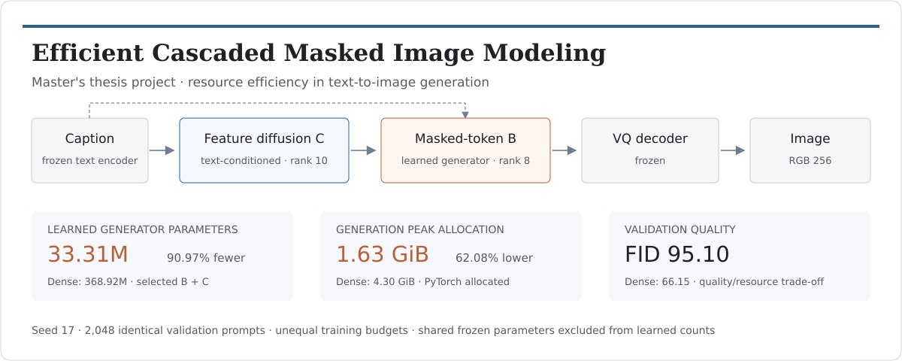
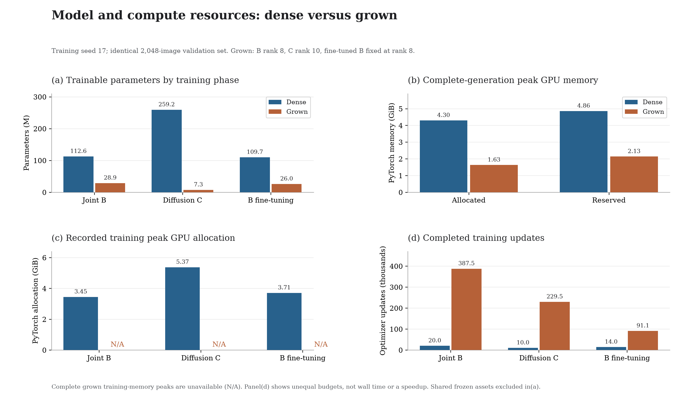
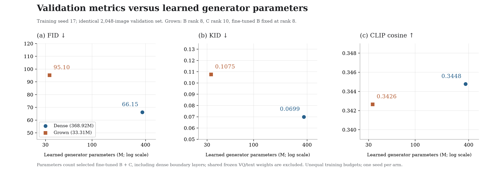
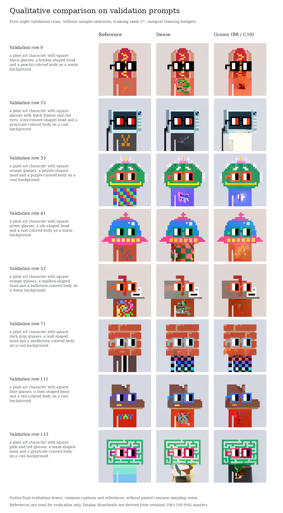
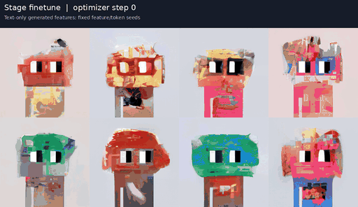
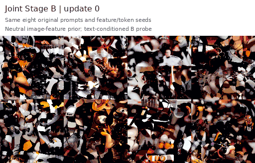
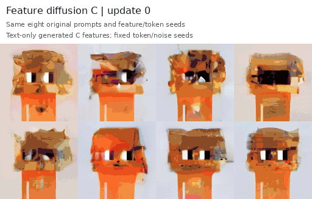
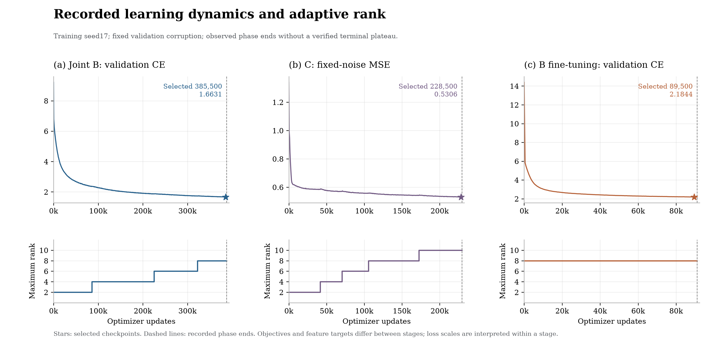
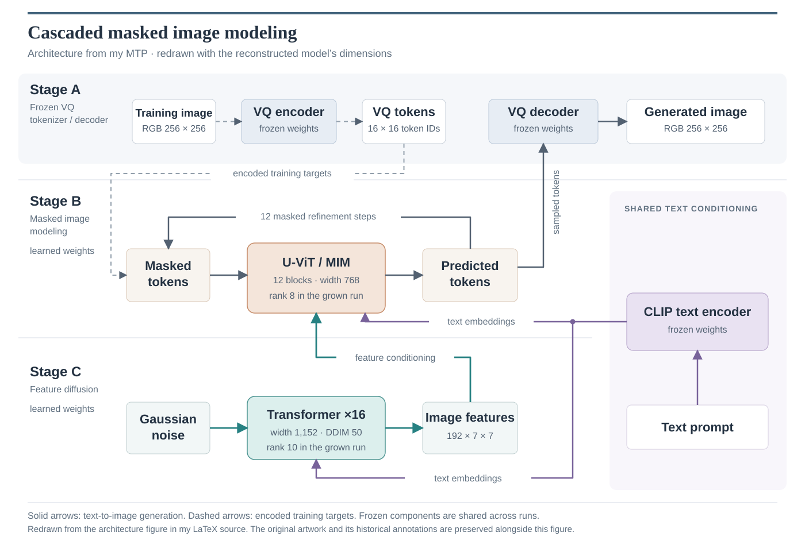

# Efficient Cascaded Masked Image Modeling

**MTP · Resource-efficient text-to-image generation**



This repository accompanies my MTP, **Efficient Text to Image Generation using Cascaded Masked Image Modeling**. I reconstructed the pipeline from my thesis sources and diagrams, then extended it on a local GPU to study the parameter and memory trade-offs of adaptive low-rank training. My original training implementation was unavailable, so I distinguish the reconstruction decisions and additional measurements from the work reported in my thesis.

My low-rank generator uses **33.31M learned parameters**, compared with **368.92M** for the dense control, and records **1.63 GiB peak generation allocation**, compared with **4.30 GiB**. Image quality remains a trade-off: dense achieves lower FID and KID. I compare both models on the same 2,048 validation prompts and training seed 17, with different training budgets.

[Training protocol](docs/TRAINING.md) · [Evaluation details](docs/EVALUATION.md) · [Reproduction](docs/REPRODUCIBILITY.md) · [Machine-readable results](results/comparison.json)

## Resource efficiency

| Quantity | Dense | Grown low-rank |
|---|---:|---:|
| Learned generator parameters, B + C | 368.92M | **33.31M** |
| Peak allocated memory during generation | 4.30 GiB | **1.63 GiB** |
| Peak reserved memory during generation | 4.86 GiB | **2.13 GiB** |
| FID ↓ | **66.15** | 95.10 |
| KID ↓ | **0.06986** | 0.10745 |
| CLIP cosine ↑ | **0.34476** | 0.34264 |

I measured **90.97% fewer learned parameters** and **62.08% lower generation allocation** for the grown generator. I count selected fine-tuned B and C, including their dense boundary layers, as learned generator parameters; shared frozen VQ/text components are excluded. GPU allocation measurements cover the complete native generation process, including the frozen components. They are PyTorch allocator measurements rather than total device memory.



I trained the grown run for more updates. I report its whole-training peak memory as unavailable because a complete peak spanning those phases was not retained. I use these results to describe a parameter/memory/quality trade-off; I do not claim a matched-budget training speedup.

## Quality versus parameter count



I compare one dense and one grown seed-17 cascade. All metrics use the same 2,048 held-out validation rows, RGB256 preprocessing, 50 DDIM steps, 12 masked refinement steps and guidance 1. I keep the reserved test split unscored. The FID protocol in my thesis was not specified fully, so I do not treat its reported value as numerically equivalent to this evaluation.

## Qualitative results



I show the first eight validation prompts in their original order, without selecting favorable samples. Captions and references match between arms; native final sampling noise is not paired. These images are separate from the fixed-seed training progression below.

## Training progression



I retain the same eight prompts and noise seeds across training. This compact preview spans fine-tuning steps 0–91,000; metrics use the selected checkpoint at 89,500. I preserve the original PNG masters and full recovery states in my local research archive.

<details>
<summary>Joint B and feature-diffusion C progression</summary>

| Joint B: neutral-feature text probe | C: generated feature conditioning |
|---|---|
|  |  |

I use 32 uniformly spaced native keyframes for each preview, preserving the original eight prompts and feature/token seeds. Last displayed steps are 387,000 for B and 229,000 for C; I document optimizer shutdown steps separately. Playback is illustrative, with no image interpolation or new model inference.

</details>

<details>
<summary>Learning curves and rank history</summary>



I let joint B grow naturally from rank 2 to 8 and C from 2 to 10, then kept B's rank 8 fixed during fine-tuning. I ended each phase before a verified terminal plateau, so I do not describe the run as fully converged.

</details>

## Method



I redrew the architecture from my LaTeX source for clearer typography and arrow routing. The dimensions and rank labels describe this reconstruction. I preserve the [original thesis diagram](assets/thesis/architecture-original.png), including its historical annotations, and explain the changes in [architecture notes](docs/ARCHITECTURE.md).

I use a frozen VQ model to map images to discrete tokens. Joint Stage B learns image features and masked image tokens; Stage C learns text-conditioned diffusion over the image-feature grid. I then fine-tune B against generated C features. Text-only inference follows **caption → feature diffusion C → masked-token B → VQ decoder → image**. I document the architecture, data splits, losses, optimization, rank growth, checkpointing and exact observed stage boundaries in the [full training account](docs/TRAINING.md).

My low-rank extension draws on **GILoRaT**, related work I coauthored: [preprint](https://doi.org/10.13140/RG.2.2.19338.17608), [code](https://github.com/DarvinX/GILoRaT). I adapt its validation-driven factorization to the generative stages and evaluate this extension separately from the original classification experiments.

## Additional evaluation

Beyond the results in my thesis, I retain FID/KID and independent CLIP embeddings and add PRDC precision/recall/density/coverage, caption retrieval at 1/5/10, alignment against shuffled captions, parameter accounting and scoped GPU-memory measurements. I explain the protocols and limitations in [evaluation details](docs/EVALUATION.md). CPU-only numerical replay uses the saved validation features; it does not require training or test evaluation.

## Repository structure

```text
code/          Measured training implementation, configurations and asset setup
analysis/      CPU-only figure generation and saved-evidence verification
assets/        Project overview
animations/    Compact fixed-seed training animations and provenance
figures/       Research figures, with PNG and vector SVG exports
results/       Comparison table, learning history and provenance
evidence/       native summaries, journals, vectors and samples
docs/           training, evaluation and reproduction account
```

I keep large datasets, pretrained weights and optimizer checkpoints outside Git. I document pinned public asset revisions and selected checkpoint SHA256 values, while preserving all original images and resumable states in my local source archive. Nothing in this repository automatically launches training or installs the recovery service.
