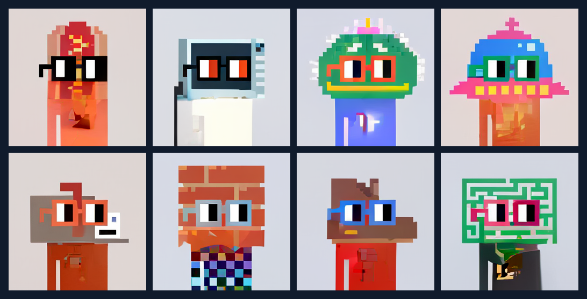

# Efficient Cascaded Masked Image Modeling

**My MTP on resource-efficient text-to-image generation**



*Generated by the selected B8/C10 model on Nouns. First eight validation prompts, in their original order.*

This repository presents my MTP, **Efficient Text to Image Generation using Cascaded Masked Image Modeling**. The work develops a text-to-image pipeline whose smaller generative stages can be trained separately, with frozen components and cached features used to reduce resource requirements. Cascaded masked image modeling and low-rank training were part of the MTP; additional dense-versus-grown measurements and training visualizations are collected here.

[Results](#results) · [Architecture](#architecture) · [Training](docs/TRAINING.md) · [Reproduce](#reproduce-the-figures) · [Evaluation details](docs/EVALUATION.md)

## Results

The grown generator uses **90.97% fewer learned parameters** and **62.08% lower measured generation allocation** than the dense control. Dense retains better FID and KID, making this a resource–quality trade-off.

| Quantity | Dense | Grown low-rank |
|---|---:|---:|
| Learned generator parameters, B + C | 368.92M | **33.31M** |
| Generation peak allocated memory | 4.30 GiB | **1.63 GiB** |
| Generation peak reserved memory | 4.86 GiB | **2.13 GiB** |
| FID ↓ | **66.15** | 95.10 |
| KID ↓ | **0.06986** | 0.10745 |
| CLIP cosine ↑ | **0.34476** | 0.34264 |

These additional measurements use one dense and one grown seed-17 cascade, the same 2,048 validation prompts, RGB256 preprocessing, 50 DDIM steps, 12 masked refinement steps and guidance 1. The grown model received more training updates. This comparison does not establish a matched-budget training speedup or replicated quality superiority.


Learned generator counts include selected fine-tuned B and C, including their dense boundary layers. Shared frozen VQ/text weights are excluded. Memory covers the complete generation process, including frozen components, and measures the PyTorch allocator rather than total device memory. Whole-training peak memory for the grown run remains unavailable. [Full accounting and metrics](docs/EVALUATION.md) · [Machine-readable results](results/comparison.json)

### Sample comparison


The first eight validation rows are shown without favorable selection. Captions and references match between arms; final sampling noise is not paired. The opening gallery contains these same grown outputs.

## Architecture


Text-only generation follows **caption → feature diffusion C → masked-token B → frozen VQ decoder → image**. During training, image features and masked tokens are first learned jointly in B. C is then trained to generate those features, followed by B fine-tuning with generated features. The staged design allows intermediate outputs and frozen-component outputs to be cached.

The diagram is redrawn from my LaTeX source, with dimensions and rank labels for the recorded implementation. The [original thesis diagram](assets/thesis/architecture-original.png) is preserved with its historical annotations; [architecture notes](docs/ARCHITECTURE.md) explain the redraw.

Low-rank training follows **GILoRaT**, related work I coauthored: [preprint](https://doi.org/10.13140/RG.2.2.19338.17608) · [code](https://github.com/DarvinX/GILoRaT).

## Training progression


The same eight prompts and noise seeds are retained across training. This compact preview spans fine-tuning steps 0–91,000; reported metrics use the selected checkpoint at 89,500. Original PNG masters and resumable states are preserved in the local research archive.

<details>
<summary>Joint B and feature-diffusion C animations</summary>

| Joint B: neutral-feature text probe | C: generated feature conditioning |
|---|---|
|  |  |

Each preview contains 32 uniformly spaced native keyframes with the original eight prompts and feature/token seeds. Last displayed steps are 387,000 for B and 229,000 for C. The B preview uses neutral image features before C is available; it is a training probe. No image interpolation or new inference is used to create these animations.

</details>

<details>
<summary>Learning curves and rank history</summary>


B grew naturally from rank 2 to 8 and C from rank 2 to 10. B's rank 8 was kept fixed during fine-tuning. All phases were stopped before a verified terminal plateau, so this run is not described as fully converged. Selected checkpoints and exact stopping steps are recorded in the [training protocol](docs/TRAINING.md).

</details>

## Reproduce the figures

Saved validation features and sample images are included, so figures and metric checks can be run on CPU:

```bash
python -m venv .venv
. .venv/bin/activate
pip install -r requirements-analysis.txt
python analysis/plot_figures.py
python analysis/verify_results.py
```

Plots are written to a new `figures-rebuilt/` directory. Verification replays FID, CLIP, PRDC and caption retrieval from saved features and checks sample hashes. KID is retained as the native estimate because the original subset draws were not serialized. [GPU setup, stage commands and checkpoint identities](docs/REPRODUCIBILITY.md) are documented separately. Large datasets, pretrained weights and optimizer checkpoints are kept outside Git.

## Additional evaluation

Alongside FID/KID and independent CLIP embeddings, this repository adds PRDC precision/recall/density/coverage, caption retrieval at 1/5/10, shuffled-caption alignment, parameter accounting and scoped GPU-memory measurements. The reserved test split remains unscored. The FID protocol in my thesis was not specified fully, so its reported value is not treated as numerically equivalent to this evaluation.

| Directory | Contents |
|---|---|
| [`code/`](code/) | Training implementation, configurations and pinned asset setup |
| [`analysis/`](analysis/) | CPU figure generation, gallery layout and metric verification |
| [`evidence/`](evidence/) | Native summaries, journals, embeddings and displayed samples |
| [`figures/`](figures/) · [`animations/`](animations/) | Research plots and compact training previews |
| [`docs/`](docs/) | Training, evaluation, architecture and reproduction protocols |

Source provenance and third-party attribution are documented in [reproduction notes](docs/REPRODUCIBILITY.md) and [NOTICE](NOTICE.md). Citation metadata is available in [CITATION.cff](CITATION.cff).
