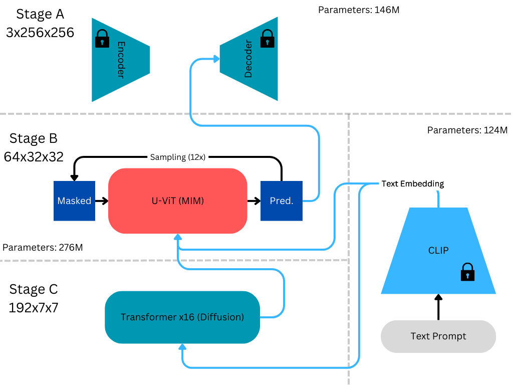

# Architecture from my MTP

This vector figure is based on the model diagram in my LaTeX source: `source/Chapters/method.tex`, which references `Images/Complete Architercture.png`. Its Stage A/B/C organization, shared CLIP conditioning, C-to-B feature cascade and iterative masked-token sampling loop are retained.

Consistent typography, aligned components, a restrained palette and separate routes for text, image features and token flow make the cascade easier to follow. Encoded training targets are distinguished by dashed arrows, and frozen components are labeled explicitly. The SVG stays sharp when enlarged.

Annotations describe the recorded implementation: RGB256 images, a 16×16 VQ token map, 192×7×7 image features, 12 masked refinement steps and 50 DDIM steps. The selected grown ranks, B=8 and C=10, describe the reported experiment rather than a requirement of the architecture. Historical parameter counts and latent-shape annotations remain in the preserved original; current parameter accounting is documented in [evaluation details](EVALUATION.md).

The encoder branch creates training tokens. At text-only inference, features are generated with C, tokens are refined with B and the image is decoded by the frozen VQ decoder. Frozen text and VQ outputs are cached during training. Complete objectives and stage dependencies are given in the [training protocol](TRAINING.md).

Original diagram from my LaTeX source

The original PNG is preserved byte for byte. Its [LaTeX figure fragment](../assets/thesis/architecture-source.tex) and [source hashes](../assets/thesis/provenance.json) record where it came from. The new figure is a presentation redraw with labels for the recorded implementation; my thesis source remains unchanged.

